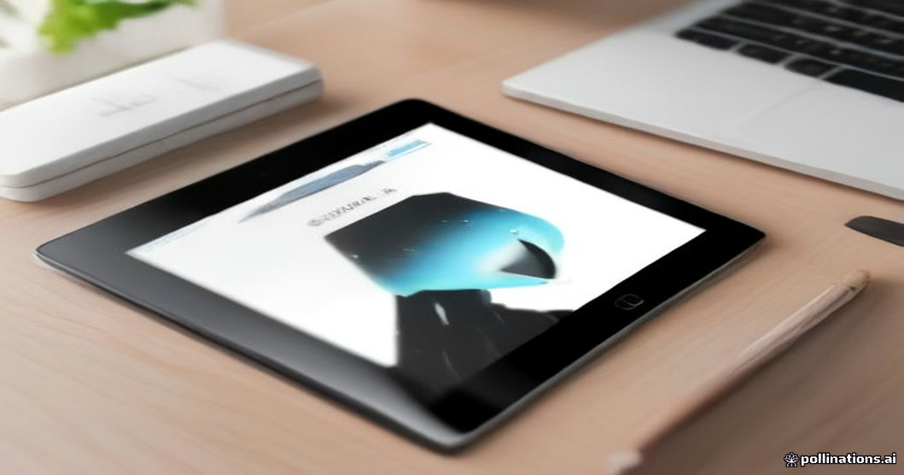

"새 태블릿 나왔다는데, 이번엔 진짜 바꿀 때가 된 걸까?" 매년 가을마다 반복되는 고민이지만, 올해는 조금 다릅니다. 2026년 10월 7일 삼성전자가 국내 출시한 **갤럭시 탭 S12 시리즈**는 안드로이드 태블릿 최초로 어도비 포토샵을 기본 탑재하면서 "노트북을 대체할 수 있는 태블릿"이라는 평가를 받고 있습니다. 그런데 전작보다 가격이 최대 25% 올랐다는 소식도 함께 들립니다. 과연 지금 지갑을 열어야 할 타이밍일까요? 실제 출고가, 배터리, S펜 포함 여부까지 꼼꼼히 따져봤습니다.

## 갤럭시 탭 S12 시리즈, 뭐가 달라졌나

갤럭시 탭 S12는 S12+와 S12 울트라 두 모델로 출시됐습니다. 가장 눈에 띄는 변화는 두께입니다. 울트라 모델은 5.1mm로 전작보다 더 얇아졌고, 플러스 모델도 5.3mm의 슬림한 바디를 유지했습니다. 얇아졌다고 배터리가 줄어든 건 아닙니다. 오히려 울트라는 11,600mAh의 대용량 배터리를 탑재해 동영상 재생 기준 최대 23시간 사용이 가능합니다. 하루 종일 외부에서 작업하는 프리랜서나 대학생에게는 충전 걱정을 크게 덜어주는 수치입니다.

두 번째 변화는 소프트웨어입니다. 안드로이드 태블릿 중 처음으로 어도비 포토샵이 기본 탑재됐는데, 이는 단순히 "앱 하나 더 깔아준다"는 의미가 아닙니다. 그동안 태블릿에서 포토샵급 보정 작업을 하려면 아이패드 프로나 윈도우 노트북으로 넘어가야 했는데, 이제는 갤럭시 생태계 안에서 S펜으로 바로 정밀 보정이 가능해졌다는 뜻입니다. 디스플레이도 2960×1848 해상도, 120Hz 주사율의 다이나믹 아몰레드 2X를 적용해 영상 편집이나 그림 작업 시 색감과 반응속도 모두 체감이 다릅니다.

## 가격, 전작보다 얼마나 올랐나

가장 화제가 된 부분은 가격입니다. 갤럭시 탭 S12 울트라는 메모리·스토리지 구성에 따라 **189만 9,700원부터 301만 8,400원**까지 책정됐습니다. 전작인 S11 울트라 대비 최대 25% 인상된 가격입니다. S12+는 상대적으로 접근하기 쉬운 **154만 9,900원부터 206만 9,100원**선입니다.

가격이 오른 이유로는 포토샵 기본 탑재에 따른 라이선스 비용, 배터리 용량 증가, 그리고 전반적인 부품 단가 상승이 꼽힙니다. 다만 S펜이 기본 제공된다는 점은 감안해야 합니다. 과거 일부 모델에서 S펜을 별도 구매해야 했던 것과 비교하면, 체감 가격 상승폭은 표면적인 수치보다는 조금 낮게 느껴질 수 있습니다.

## 울트라 vs 플러스, 나에게 맞는 모델은

"어차피 비싼 거 살 거면 제일 좋은 걸로"라는 생각은 태블릿 구매에서는 조심해야 할 함정입니다. 두 모델의 실제 활용 목적이 다르기 때문입니다.

| 항목 | 갤럭시 탭 S12+ | 갤럭시 탭 S12 울트라 |
|---|---|---|
| 화면 크기 | 12.6형 | 14.6형 |
| 두께 | 5.3mm | 5.1mm |
| 무게 | 553g(Wi-Fi) / 555g(5G) | 692g~695g |
| 배터리 용량 | 10,600mAh | 11,600mAh |
| 동영상 재생 시간 | 최대 21시간 | 최대 23시간 |
| 충전 방식 | 45W 유선, 약 95분 완충 | 45W 유선, 약 95분 완충 |
| 메모리/스토리지 | 12GB/256·512GB | 12GB·16GB / 256GB·512GB·1TB |
| S펜 | 기본 제공 | 기본 제공(헥사곤 디자인) |
| 국내 출고가 | 154만 9,900원~206만 9,100원 | 189만 9,700원~301만 8,400원 |

이 표에서 주목할 부분은 무게 차이입니다. 울트라는 플러스보다 약 140g 더 무거운데, 14.6형 대화면을 손에 들고 작업하는 시간이 길다면 이 차이가 손목 피로로 직결됩니다. 반대로 책상 위에 거치해두고 영상 편집·그림 작업 중심으로 쓴다면 화면이 큰 울트라가 압도적으로 유리합니다. **"이동 중에도 자주 손에 들고 쓴다면 플러스, 거치해두고 모니터처럼 쓴다면 울트라"**가 가장 현실적인 선택 기준입니다.

## 많은 사람이 놓치는 포인트 - 충전기와 저장공간

제품 출시 기사들이 잘 다루지 않는 부분이 바로 충전 인프라입니다. 두 모델 모두 USB-C 단자를 통해 45W 유선 충전을 지원하며, 완충까지 약 95분이 걸립니다. 문제는 45W를 제대로 뽑아내려면 PD(Power Delivery) 규격을 지원하는 고속 충전기가 필요하다는 점입니다. 기존에 쓰던 저전력 충전기를 그대로 연결하면 완충 시간이 2배 이상 늘어날 수 있으니, 구매 전에 반드시 호환 충전기를 함께 확인해야 합니다.

저장공간도 신중하게 골라야 하는 항목입니다. 포토샵으로 고해상도 이미지 작업을 하거나 4K 영상을 편집한다면 256GB는 금방 포화 상태가 됩니다. 클라우드를 적극 활용할 계획이 없다면 최소 512GB 이상을 권장합니다. 특히 울트라 16GB·1TB 모델은 최상위 가격대인 301만 원대로, 일반 사용자에게는 과한 사양일 수 있으니 본인의 실제 작업량을 먼저 점검하는 것이 현명합니다.

## 지금 사야 할까, 기다려야 할까

신제품이 나오면 항상 따라붙는 질문입니다. 출시 직후 구매의 장점은 최신 안드로이드 17 기반 One UI를 가장 오래 지원받을 수 있다는 점입니다. 반면 초기 물량에서는 간혹 소프트웨어 최적화 이슈가 보고되기도 하므로, 급한 용도가 아니라면 출시 후 1~2개월 뒤 펌웨어 업데이트가 한두 차례 돌고 나서 구매하는 것도 합리적인 선택입니다.

가격에 민감하다면 통신사 결합 할인이나 기존 기기 보상판매 프로그램을 적극 활용하는 것을 추천합니다. 특히 전작인 S11 시리즈 사용자라면 보상판매 시 체감 가격을 상당히 낮출 수 있어, 정가만 보고 구매를 포기하기 전에 각 유통채널의 프로모션을 먼저 비교해보는 것이 좋습니다.

<figure>
  
  <figcaption>▲ S펜과 함께 사용하는 프리미엄 태블릿 이미지 / AI 생성 이미지</figcaption>
</figure>

## 자주 묻는 질문

**Q1. 갤럭시 탭 S12는 전화(5G) 기능이 되나요?**
Wi-Fi 전용 모델과 5G 모델이 별도로 출시됩니다. 5G 모델은 무게가 Wi-Fi 모델보다 약 2g 더 무겁고 가격도 조금 더 높게 책정되니, 테더링만으로 충분하다면 Wi-Fi 모델이 더 경제적입니다.

**Q2. 포토샵은 평생 무료로 쓸 수 있나요?**
기본 탑재는 됐지만 모든 기능을 무제한으로 쓰려면 어도비 구독이 필요할 가능성이 높습니다. 기본 제공 범위와 구독 전환 조건은 실제 기기 수령 후 어도비 앱 내 안내를 통해 확인하는 것이 정확합니다.

**Q3. S펜을 잃어버리면 따로 구매해야 하나요?**
네, 기본 제공되는 S펜은 분실 시 별도 구매해야 합니다. 헥사곤 디자인으로 바뀌면서 기존 S펜 액세서리와 호환되지 않을 수 있으니, 케이스나 거치대를 구매할 때도 신형 S펜 규격을 확인해야 합니다.

**Q4. 기존 갤럭시 탭 S9, S10 사용자도 업그레이드할 가치가 있나요?**
배터리 사용 시간과 두께 개선 정도만 본다면 S10 사용자는 당장 급하게 바꿀 필요는 없습니다. 다만 포토샵 등 전문 작업용 소프트웨어를 자주 쓴다면 S9 이하 사용자에게는 체감 성능 차이가 클 수 있습니다.

**Q5. 해외 직구가 국내 구매보다 저렴한가요?**
환율과 관세, A/S 제한을 고려하면 단순 기기값만 비교해서는 안 됩니다. 특히 태블릿은 고장 시 수리비가 비싼 편이라, 가격 차이가 크지 않다면 국내 정식 출고 모델을 구매해 무상 A/S를 받는 편이 장기적으로 유리합니다.

## 핵심 정리

갤럭시 탭 S12 시리즈는 더 얇아진 디자인과 최대 23시간 배터리, 안드로이드 최초 포토샵 기본 탑재로 "노트북 대체 태블릿"이라는 포지션을 확실히 굳혔습니다. 다만 전작 대비 최대 25% 오른 가격은 분명한 부담 요인입니다. 이동 중 사용 빈도가 높다면 553g의 S12+, 책상 거치형 작업이 많다면 14.6형 화면의 울트라를 선택하는 것이 합리적입니다. 구매 전에는 45W PD 고속 충전기 보유 여부와 저장공간 사용 패턴을 먼저 점검하고, 통신사·제조사의 보상판매 프로모션을 비교한 뒤 결정하시길 권합니다.

**출처**: [삼성전자 뉴스룸 코리아 - 갤럭시 탭 S12 시리즈 공개](https://news.samsung.com/kr/%EC%82%BC%EC%84%B1%EC%A0%84%EC%9E%90-%EA%B0%A4%EB%9F%AD%EC%8B%9C-%ED%83%AD-s12-%EC%8B%9C%EB%A6%AC%EC%A6%88-%EA%B3%B5%EA%B0%9C) | [삼성전자 공식 판매 페이지 - 갤럭시 탭 S12+](https://www.samsung.com/sec/tablets/galaxy-tab-s12-plus/)
